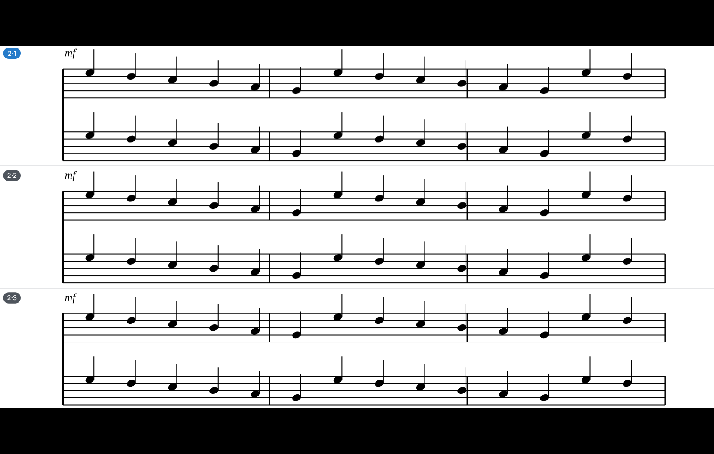
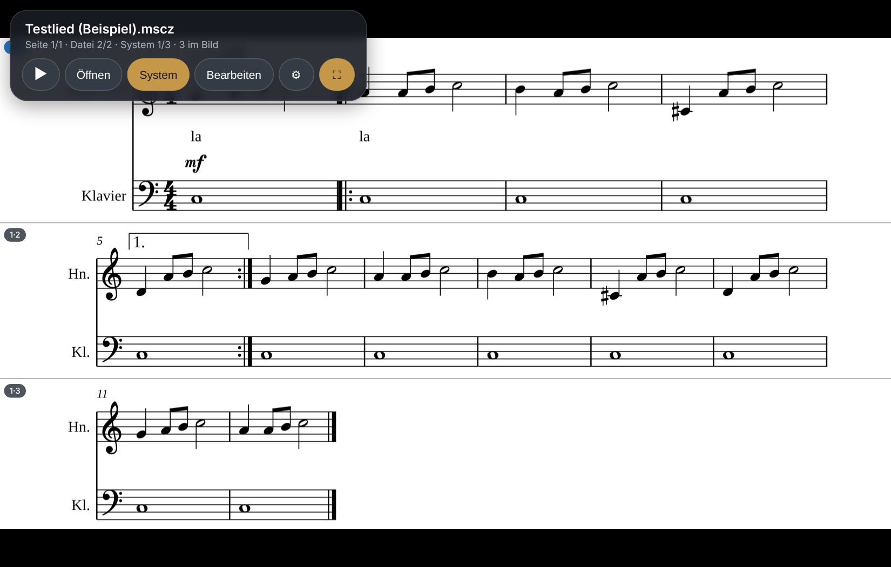

# NotenLeser

**Noten im Vollbild lesen und systemweise blättern – im Browser und in Nextcloud.**

NotenLeser zeigt PDF-Noten und MuseScore-Dateien so, dass beim Musizieren immer die nächsten Systeme (Notenzeilen) im Bild sind. Statt ganzer Seiten wird **System für System** geblättert, auch über Seitengrenzen hinweg – per Wischen, Tastatur, Bluetooth-Blätterpedal oder Handbewegung vor der Kamera.

**Web-App ausprobieren:** https://mannimanfred.github.io/NotenLeser/ („Beispiel ansehen“ öffnet Beispielnoten)

| PDF mit erkannten Systemen | MuseScore-Datei, direkt gesetzt |
|---|---|
|  |  |

## Funktionen

- **Automatische Systemerkennung in PDFs:** Notenzeilen werden im Bild gefunden und zu Systemen zusammengefasst. Deckblätter ohne Noten werden übersprungen. Wenn die Erkennung danebenliegt, lassen sich Systeme im Bearbeitungsmodus selbst markieren.
- **MuseScore-Dateien** (`.mscz`, `.mscx`, Version 2–4) werden direkt gesetzt, mit der Notenschrift Leland, und lassen sich **abspielen**. Der klingende Takt wird markiert, und es wird automatisch weitergeblättert.
- **Mehrere Systeme gleichzeitig**, so viele auf den Bildschirm passen; „Immer mindestens 2 Systeme“ zum Vorauslesen.
- **Eigene Stimme hervorheben:** Die gewählte Notenzeile (1.–6. Stimme) wird in jedem System farbig hinterlegt.
- **Blättern ohne Hände:** Bluetooth-Pedale (AirTurn, PageFlip u. a.) oder eine Handbewegung vor der Frontkamera. Die Kamerabilder werden nur im Browser ausgewertet.
- **Notenmappe:** Wischen nach oben/unten wechselt zur nächsten Datei im Ordner.
- **Vollbild**, Display bleibt an.
- Markierte Systeme werden als `<Name>.systems.json` neben den Noten gespeichert. Das Format ist in beiden Versionen gleich, sodass Markierungen z. B. über Nextcloud zwischen den Geräten wandern.

## Versionen

| | Wo | Dateien kommen aus | Details |
|---|---|---|---|
| **Web-App** | [mannimanfred.github.io/NotenLeser](https://mannimanfred.github.io/NotenLeser/), installierbar, offline nutzbar | Dateien oder Ordner vom Gerät; nichts wird hochgeladen | [`nextcloud/README.md`](nextcloud/README.md#web-app-ohne-nextcloud-github-pages) |
| **Nextcloud-App** | eigene Nextcloud (30–33) | Nextcloud-Dateien, Öffnen direkt aus der Dateien-App | [`nextcloud/README.md`](nextcloud/README.md) |

Web-App und Nextcloud-App teilen sich denselben Code (`nextcloud/src/`). Auf Android-Handys lässt sich die Web-App über Chrome zum Startbildschirm hinzufügen und läuft dann wie eine App im Vollbild.

## Bauen

```sh
# Web- und Nextcloud-App (Node.js 24)
cd nextcloud
npm ci
npm test
npm run dev           # Entwicklungsserver: http://localhost:8085/
npm run build:pages   # Web-App nach dist-pages/
npm run package       # Nextcloud-App als build/notenleser-<version>.tar.gz
```

GitHub Actions veröffentlicht die Web-App auf GitHub Pages und baut das Nextcloud-Paket als Artefakt.

## Mitmachen

Fehler und Wünsche gerne als [Issue](https://github.com/ManniManfred/NotenLeser/issues). Am hilfreichsten ist eine Beispieldatei, bei der die Systemerkennung oder der MuseScore-Satz danebenliegt (sofern sie weitergegeben werden darf).

## Lizenz

NotenLeser steht unter der [GNU Affero General Public License v3.0 oder später](LICENSE) (AGPL-3.0-or-later).
Wer eine geänderte Version als Webdienst anbietet, muss den Nutzern den Quellcode zugänglich machen.

Mitgelieferte Bestandteile Dritter – u. a. die Notenschrift Leland (SIL Open Font License 1.1), pdf.js (Apache-2.0) und Nextcloud-Bibliotheken (GPL/AGPL) – sind in [`THIRD-PARTY-NOTICES.md`](THIRD-PARTY-NOTICES.md) aufgeführt.
